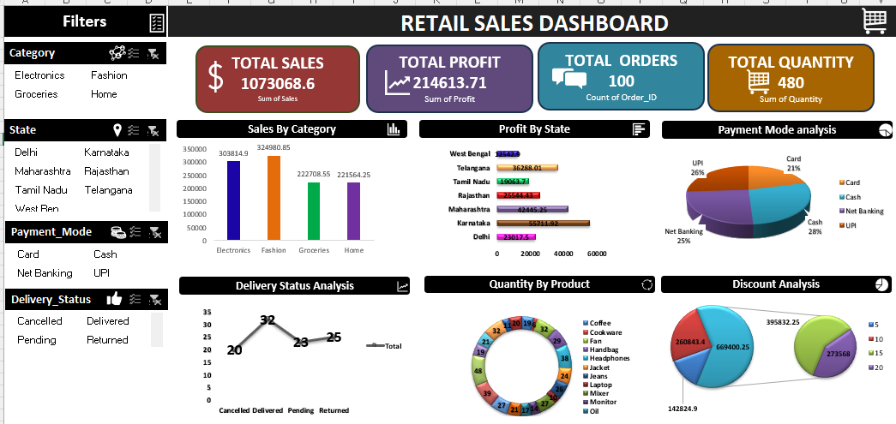

# Retail Sales Dashboard

An interactive retail sales dashboard built in Microsoft Excel.

## Tools
Microsoft Excel, Advanced Excel

## Features
- 6 PivotTables and 6 PivotCharts
- 4 interactive slicers
- KPI cards for sales, profit, orders and quantity
- Analysis by category, state, payment mode, delivery status and product

## Files
- Retail_dataset.xlsx: the dashboard workbook

## Dashboard preview

